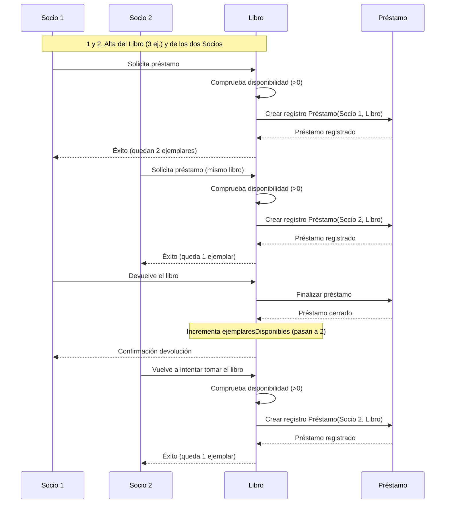

# Ejercicio 1 — Diseño con Tarjetas CRC

> **ENUNCIADO**
> 
> Supón que debes desarrollar un sistema de gestión de una biblioteca. El sistema debe permitir:
> - Registrar libros con título, autor, ISBN y número de ejemplares disponibles.
> - Registrar socios con nombre, número de socio y fecha de alta.
> - Gestionar préstamos: un socio puede tomar prestado un libro si hay ejemplares disponibles.
> - Devolver un libro prestado, actualizando los ejemplares disponibles.
>
> **Tarea:**
> 1. Diseña las tarjetas CRC para las clases **Libro**, **Socio** y **Préstamo**. Para cada una indica:
>    - Responsabilidades (qué sabe y qué sabe hacer).
>    - Colaboradores (con qué otras clases interactúa).
> 2. Describe, para la clase **Libro**, qué debería ocurrir cuando se intenta prestar un ejemplar: qué se comprueba antes de prestarlo y qué cambia en el objeto si el préstamo tiene éxito o si no lo tiene.
> 3. Describe con tus palabras el siguiente flujo, indicando en cada paso qué clase actúa y qué colaboradores necesita:
>    - Se da de alta un libro con 3 ejemplares.
>    - Se dan de alta dos socios.
>    - El primer socio toma prestado el libro (¿tiene éxito?).
>    - El segundo socio intenta tomar el mismo libro (¿tiene éxito?).
>    - El primer socio devuelve el libro.
>    - El segundo socio vuelve a intentar tomar el libro (¿tiene éxito?).

---

## 1. Tarjetas CRC

### Tarjeta CRC: Libro

| **Clase: Libro** |  | 
| ----- | ----- | 
| **Responsabilidades** | **Colaboradores** | 
| Almacenar sus datos identificativos (título, autor e ISBN). | — | 
| Controlar y mantener actualizado el número de ejemplares disponibles. | — | 
| Procesar la salida de un ejemplar cuando se efectúa un préstamo. | Préstamo | 
| Procesar la entrada de un ejemplar cuando se efectúa una devolución. | Préstamo | 

### Tarjeta CRC: Socio

| **Clase: Socio** |  | 
| ----- | ----- | 
| **Responsabilidades** | **Colaboradores** | 
| Guardar los datos del usuario (nombre, número de socio y fecha de alta). | — | 
| Iniciar la solicitud de préstamo de un libro. | Libro, Préstamo | 
| Solicitar la devolución de un libro que tiene prestado. | Préstamo | 

### Tarjeta CRC: Préstamo

| **Clase: Préstamo** |  | 
| ----- | ----- | 
| **Responsabilidades** | **Colaboradores** | 
| Registrar la vinculación activa entre un socio y un libro determinado. | Libro, Socio | 
| Guardar la fecha de inicio del préstamo. | — | 
| Registrar la finalización o cierre de la transacción tras la devolución. | Libro | 

---

## 2. Comportamiento de la clase Libro

Al intentar prestar un ejemplar, el flujo interno de la clase `Libro` es el siguiente:

1. **Comprobación previa:** Antes de confirmar el préstamo, la clase `Libro` evalúa si el atributo de ejemplares disponibles es estrictamente mayor que cero ( $ejemplaresDisponibles > 0$ ).

2. **En caso de éxito (hay disponibilidad):**
   * Se genera una instancia en la clase `Préstamo` que conecta al `Socio` con el `Libro`.
   * El atributo de ejemplares disponibles en el objeto `Libro` disminuye en 1 unidad.

3. **En caso de fallo (no hay disponibilidad):**
   * La solicitud se deniega y no se crea ninguna entidad en `Préstamo`.
   * El contador de ejemplares del objeto `Libro` no sufre ninguna modificación.

4. **Durante la devolución:**
   * La entidad `Préstamo` correspondiente se marca como cerrada o finalizada.
   * El objeto `Libro` incrementa en 1 unidad su contador de ejemplares disponibles.

---

## 3. Explicación del flujo paso a paso y Diagrama de Secuencia

Dado que el libro inicia con **3 ejemplares**, en ningún momento se agota el stock disponible, por lo que **todas las peticiones de préstamo en este flujo resultan exitosas**.

### Descripción paso a paso
* **Paso 1 (Alta del libro):** Se instancia la clase `Libro` configurando un total de 3 ejemplares disponibles.
* **Paso 2 (Alta de socios):** Se crean dos objetos de la clase `Socio` (`Socio 1` y `Socio 2`).
* **Paso 3 (Socio 1 solicita el libro):** El `Socio 1` realiza la petición. La clase `Libro` comprueba que existen 3 ejemplares disponibles, por lo que la operación **tiene éxito**. Se reduce el stock a 2 y colabora con `Préstamo` para registrar la salida.
* **Paso 4 (Socio 2 solicita el libro):** El `Socio 2` realiza su petición sobre el mismo libro. Al quedar 2 ejemplares disponibles, la operación **tiene éxito**. Se actualiza el stock a 1 y se genera el objeto `Préstamo`.
* **Paso 5 (Socio 1 devuelve el libro):** El `Socio 1` tramita la devolución. La clase `Préstamo` marca el registro como finalizado y el objeto `Libro` suma un ejemplar, pasando el stock de nuevo a 2.
* **Paso 6 (Socio 2 vuelve a solicitar el libro):** El `Socio 2` pide un nuevo ejemplar. Al haber 2 disponibles, la operación **vuelve a tener éxito**. El stock final pasa a ser de 1 ejemplar y se genera un nuevo `Préstamo`.

### Diagrama de Secuencia

### Tabla Resumen de Estados

| Paso | Acción | ¿Tiene éxito? | Ejemplares disponibles tras la acción |
| :---: | :--- | :---: | :---: |
| **1** | Alta del libro | — | 3 |
| **2** | Socio 1 solicita préstamo | **Sí** | 2 |
| **3** | Socio 2 solicita préstamo | **Sí** | 1 |
| **4** | Socio 1 devuelve el libro | — | 2 |
| **5** | Socio 2 solicita un nuevo préstamo | **Sí** | 1 |