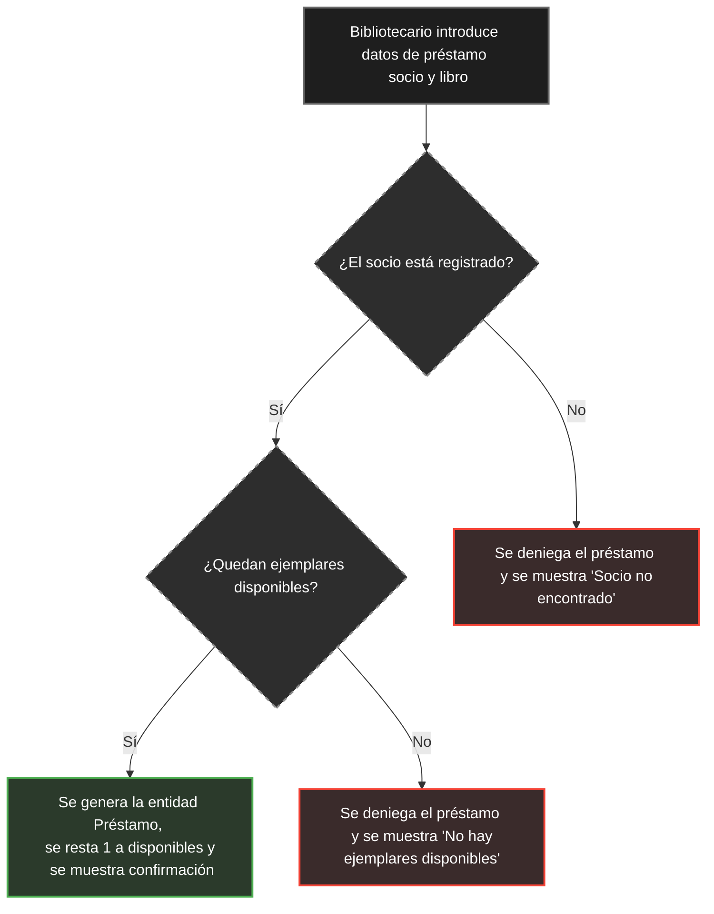

# Ejercicio 4 — Redacción de historias de usuario

> **ENUNCIADO**
>
> Retoma el sistema de gestión de la biblioteca del Ejercicio 1.
>
> **Tarea:**
>
> 1. Redacta al menos tres historias de usuario (formato "Como... quiero... para...") que cubran distintos roles: el socio, el bibliotecario y un administrador del sistema.
>
> 2. Para cada historia, comprueba que cumple los criterios INVEST (Independiente, Negociable, Valiosa, Estimable, Pequeña, Testeable). Si alguna no los cumple, reformúlala.
>
> 3. Elige una de las historias y escribe sus criterios de aceptación en formato Dado-Cuando-Entonces (al menos dos criterios).

## 1. Historias de Usuario

* **Historia 1 (Rol: Socio)**
  **Como** usuario registrado (socio), **quiero** poder buscar libros en el sistema filtrando por título o autor, **para** comprobar si hay ejemplares libres en la biblioteca antes de hacer el viaje de forma presencial.

* **Historia 2 (Rol: Bibliotecario)**
  **Como** personal de la biblioteca, **quiero** registrar informáticamente cuándo un socio se lleva un libro, **para** saber en todo momento el stock real y quién tiene cada ejemplar prestado.

* **Historia 3 (Rol: Administrador)**
  **Como** administrador del sistema, **quiero** generar una lista con los títulos más prestados durante los últimos 30 días, **para** que dirección sepa qué libros tienen más éxito y puedan planificar nuevas compras.
  *(Nota: Se han descartado opciones de exportación a Excel o filtros complejos de fechas para mantener la historia acotada y pequeña).*

## 2. Comprobación de los criterios INVEST

| Criterio | H1 (Buscador del socio) | H2 (Registro de préstamo) | H3 (Lista de más prestados) | 
| ----- | ----- | ----- | ----- | 
| **Independent** (Independiente) | Sí. Que el socio busque un libro no afecta a que el bibliotecario preste otro. | Sí. Funciona por sí sola como operativa básica. | Sí, aunque lógicamente necesita que la base de datos tenga historial previo de préstamos. | 
| **Negotiable** (Negociable) | Sí. No impone tecnología (puede ser una barra simple, un menú desplegable, etc.). | Sí. El método de registro (escáner láser o teclado) queda abierto. | Sí. El formato visual del listado se puede debatir con el equipo de desarrollo. | 
| **Valuable** (Valiosa) | Sí. Ahorra tiempo y frustración al usuario al evitar viajes innecesarios. | Sí. Es la operativa crítica (el "core") de cualquier biblioteca. | Sí. Permite tomar decisiones de negocio basadas en datos reales. | 
| **Estimable** (Estimable) | Sí. El equipo de desarrollo puede calcular su dificultad sin problema. | Sí. Es una operación directa en la base de datos. | Sí, es una consulta y ordenación estándar a la base de datos. | 
| **Small** (Pequeña) | Sí. Es una funcionalidad muy concreta ideal para un único sprint. | Sí. Es el flujo básico sin complicaciones ni casuísticas añadidas. | Sí. Al haber eliminado la exportación y los filtros extra en la reformulación, su tamaño es manejable. | 
| **Testable** (Testeable) | Sí. Si busco "Dune" y el sistema lo tiene, debe mostrar "Disponible". | Sí. Si presto un libro, el stock visible debe bajar en 1 unidad. | Sí. Si presto un libro hoy, mañana debe sumar un +1 en su estadística mensual. | 

## 3. Criterios de Aceptación (Historia 2 — Bibliotecario)

Tomando como base el comportamiento lógico de la clase `Libro` definido en la fase de diseño (Ejercicio 1), los criterios de aceptación para el registro de un préstamo son:

**Criterio 1: Préstamo con éxito (Hay stock disponible)**

* **Dado** que el libro "Patria" tiene al menos 1 ejemplar disponible (comprobación previa de `ejemplaresDisponibles > 0`) y el Socio 1 está dado de alta en el sistema.

* **Cuando** el bibliotecario registra el préstamo del libro al Socio 1.

* **Entonces** el sistema genera una instancia en la clase `Préstamo` que conecta al Socio con el Libro, y el atributo de ejemplares disponibles disminuye en 1 unidad.

**Criterio 2: Préstamo denegado (No hay stock)**

* **Dado** que el libro "Patria" tiene 0 ejemplares disponibles en este momento.

* **Cuando** el bibliotecario intenta registrar un nuevo préstamo de ese libro.

* **Entonces** la solicitud se deniega, no se crea ninguna entidad en la clase `Préstamo` y el contador de ejemplares del objeto `Libro` no sufre ninguna modificación.

**Criterio 3 (Adicional): Socio no registrado**

* **Dado** que un libro tiene ejemplares disponibles pero el número de socio introducido no existe en la base de datos.

* **Cuando** el bibliotecario intenta registrar el préstamo.

* **Entonces** el sistema muestra un error de validación, la solicitud se deniega (no se crea la entidad `Préstamo`) y el contador de ejemplares del `Libro` no sufre modificación.